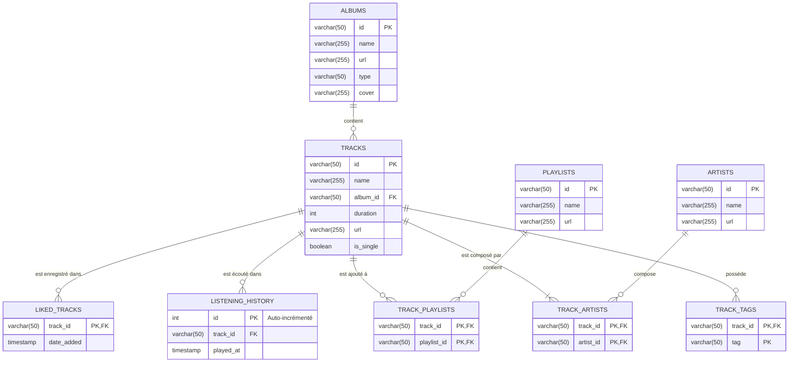

# Documentation - Spotiapp

#

# Exécution des tests

## Test de connexion au serveur

Se placer à la racine.

```zsh
uv run pytest
```

Le test est censé passer sans erreur. Si le test remonte une erreur ou ne termine pas, l'IP attribuée au serveur a probablement changée. Dans ce cas:

1. Vérifier que le container est bien actif (ouvrir un terminal Ubuntu et run `docker ps`)
2. Vérifier l'IPv4 du serveur (ouvrir un terminal PowerShell et run `ipconfig` puis prendre l'IPv4 de la carte Wi-Fi)
3. Si l'IP a changé, mettre à jour le `.env`.

# Exécution du code

## Mise à jour de l'architecture de BDD

Se placer dans `src/spotiapp`.

```zsh
uv run -m main update-db  {*chemin_relatif_depuis_la_racine_vers_le_script_de_maj*}
```

## Mise à jour du contenu de la BDD

Se placer dans `src/spotiapp`.

```zsh
uv run -m main run
```

## Utilisation de dbt

Pour toutes les commandes, se placer dans `spotiapp_dbt`.

### Test

```zsh
uv run dbt test
```

### Compilation

```zsh
uv run dbt run
```

### Commande principale

```zsh
uv run dbt build
```

Cette commande effectue la compilation ainsi que tous les tests automatiquement.

# Schéma de la base de données


